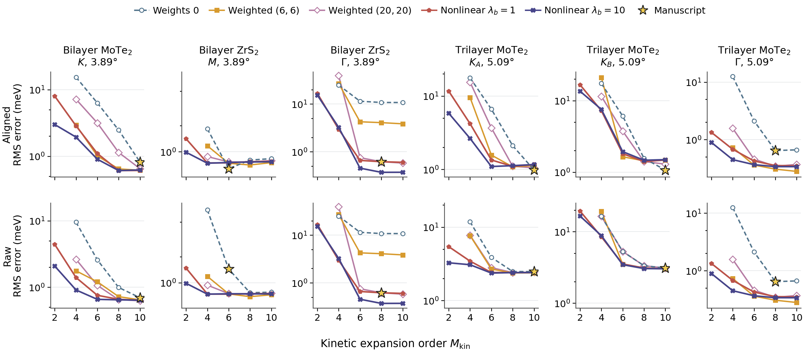

# Kinetic expansion order

The upper row compares band RMS errors using the manuscript's energy alignment. The
lower row uses raw energies. Each column covers one of the six manuscript models.
Stars mark the orders and linear coefficient-extraction settings used in the manuscript.



[Vector PDF](figures/kinetic_order_convergence.pdf) · [Summary CSV](data/summary.csv) ·
[Band data](data/path_bands.npz) · [Figure caption](captions.txt)

The linear series use orders 4, 6, 8, and 10 with zero matrix weights or with
6- and 20-state windows. The nonlinear series use band weights 1 and 10 and also
include order 2. The order scan keeps the projected basis and the intralayer
and interlayer orders fixed. The [original model configurations](../README.md)
specify the six manuscript examples.

Run from a checkout with NumPy and Matplotlib installed:

```bash
python examples/kinetic_order_validation/render_figures.py
```

The script verifies all 132 model/order/settings combinations against their
61-point model and TAPW spectra in `data/path_bands.npz` and regenerates the
figure. The arrays use eV. Each pair is named `s{series}_{case}_k{order}_model`
and `s{series}_{case}_k{order}_tapw`. The alignment offsets, window sizes, and
RMS values are in `data/summary.json`. The nonlinear curves report the results
of finite optimization runs.

The kinetic cutoff applies to positive-degree terms at zero momentum transfer
within a sector. Intralayer coupling order controls nonzero-transfer terms.
The archived sweep uses this corrected cutoff.
